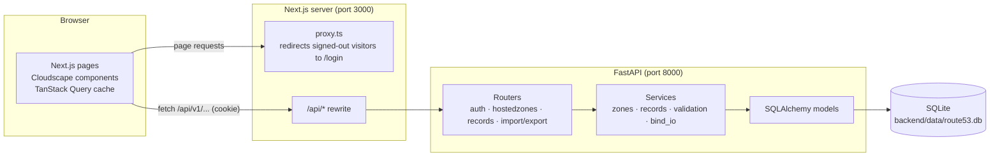
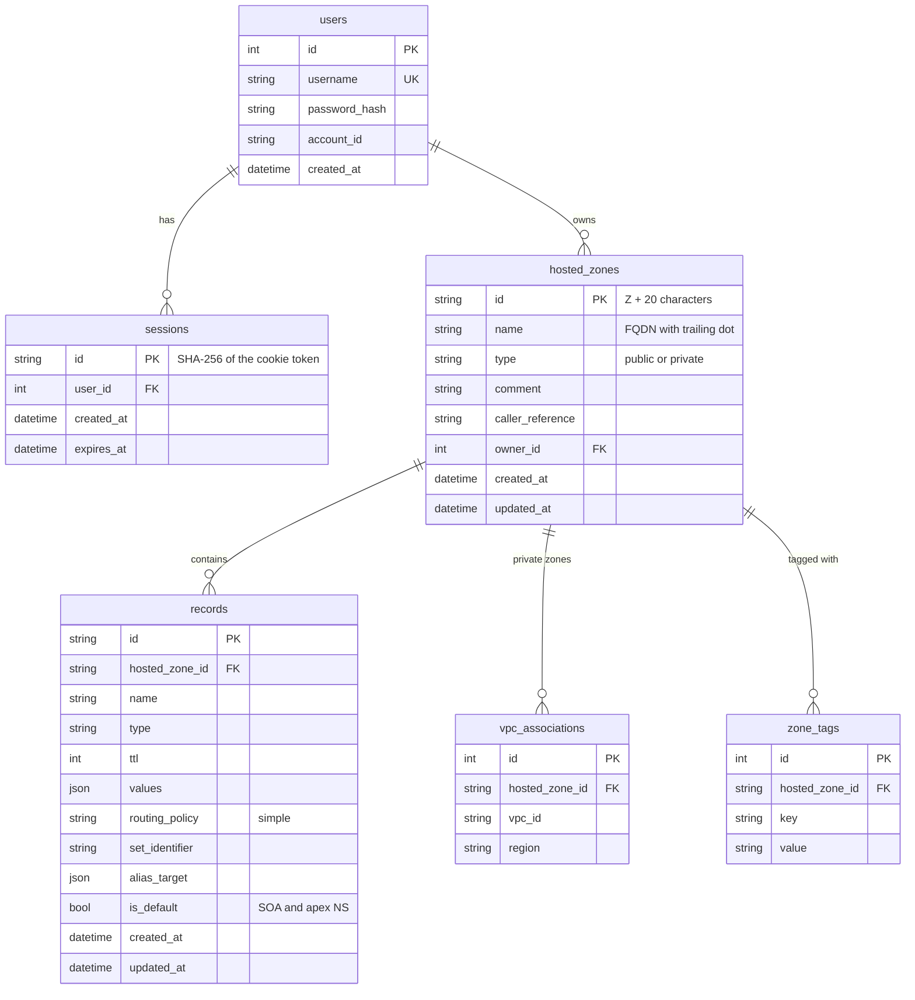

# Route 53 Console Clone

A working replica of the Amazon Route 53 management console, built as a full-stack assignment.
You sign in, create hosted zones, and manage DNS records through screens that follow the real
console's layout, wording and components. Nothing talks to AWS and no DNS is served: every
zone and record lives in a local SQLite database behind a FastAPI backend.

> **Disclaimer:** Educational project. Not affiliated with, endorsed by, or connected to Amazon
> Web Services. AWS and Route 53 are trademarks of Amazon.com, Inc. or its affiliates.

**Live demo:** https://aws-route53-clone-fawn.vercel.app (API: https://route53-clone-api-fldv.onrender.com/docs)
The backend runs on a free instance that sleeps when idle, so the first sign-in after a pause can
take about a minute, and demo data resets to the seed whenever it restarts.
**Demo sign-in:** IAM user name `admin`, password `admin123` (account ID `123456789012` is filled in for you)


---

## Contents

- [Features](#features)
- [Tech stack](#tech-stack)
- [Getting started](#getting-started)
- [Deployment](#deployment)
- [Running the tests](#running-the-tests)
- [Architecture](#architecture)
- [Database schema](#database-schema)
- [API overview](#api-overview)
- [Screenshots](#screenshots)
- [Known limitations](#known-limitations)
- [Credits and third-party licenses](#credits-and-third-party-licenses)

---

## Features

Every item below maps to a requirement in [docs/ASSIGNMENT.md](docs/ASSIGNMENT.md).

### Required

| Area | What you can do |
|---|---|
| **Sign-in (mocked)** | Sign in as an IAM user, stay signed in across reloads and browser restarts (server-side session + `httpOnly` cookie), sign out from the account menu. Visiting a console page while signed out sends you to the sign-in page and back again afterwards. |
| **Hosted zones** | List with search, sorting (name, record count), pagination and column preferences (the API also filters by zone type). Create public or private zones (VPCs, description, tags). View details with name servers. Edit description and tags. Delete with a type-"delete"-to-confirm dialog; zones that still hold your own records are refused, as in Route 53. |
| **DNS records** | A, AAAA, CNAME, TXT, MX, NS, PTR, SRV and CAA. Records table with search, type / routing / alias filters and pagination. "Quick create" page that adds several records in one go. Edit a record in the split panel. Delete one or many records. Every type is validated (IP formats, hostnames, MX priority, SRV fields, CAA tags, TTL range, names inside the zone, CNAME exclusivity, duplicates). |
| **Default records** | Each new zone gets an SOA and four NS records. Their TTL and values can be edited, but they can't be renamed or deleted (same messages as Route 53). |
| **Console experience** | Dark top bar, Route 53 side navigation, breadcrumbs, help panels behind "Info" links, Flashbar notifications, modals, split panel — all built from Cloudscape, the design system the AWS console itself uses. |
| **Coming soon pages** | Dashboard, Traffic policies, Health checks, Resolver, Profiles and the other side-nav sections show a placeholder page. |
| **Persistence** | All data is in SQLite (`backend/data/route53.db`) and survives restarts. |

### Bonus

| Feature | Details |
|---|---|
| **BIND import** | "Import zone file" on the records tab: paste text or upload a file (up to 1 MB), preview every record set with its status (ready / skipped / error with line number), then import the ready ones in one transaction. Understands `$ORIGIN`, `$TTL`, comments, multi-line parentheses, `@` and relative names. |
| **Export** | "Export zone file" on a zone: download as a BIND zone file or as JSON. |
| **Bulk operations** | Select several hosted zones or records and delete them together; partial failures are reported per item. |
| **Dark mode** | Toggle in the top bar settings menu; remembered across visits and applied before the first paint. |
| **Keyboard shortcuts** | `/` focus search, `c` create, `r` refresh, `?` list shortcuts. Ignored while typing or when a dialog is open. |

---

## Tech stack

| Layer | Choice |
|---|---|
| Frontend | Next.js 16 (App Router) + TypeScript (strict), Cloudscape Design System, TanStack Query |
| Backend | Python 3.11+ (developed on 3.14), FastAPI, SQLAlchemy 2, Pydantic v2, Alembic, dnspython |
| Database | SQLite |
| Tests | pytest + httpx (backend), Vitest + React Testing Library (frontend), Playwright (end to end) |

---

## Getting started

You need **Python 3.11 or newer**, **Node.js 20 or newer** (developed on 22) and **git**.

### 1. Clone

```bash
git clone <repository-url> AWS_Route53_Clone
```

```bash
cd AWS_Route53_Clone
```

### 2. Backend (FastAPI, port 8000)

```bash
cd backend
python3 -m venv .venv
.venv/bin/pip install -r requirements-dev.txt   # requirements.txt alone is enough to run it
cp .env.example .env                            # optional: every setting has a local default
.venv/bin/alembic upgrade head                  # creates backend/data/route53.db
.venv/bin/python -m app.db.seed                 # demo user + two sample zones
.venv/bin/uvicorn app.main:app --reload
```

The API is now at http://localhost:8000 and its interactive docs at http://localhost:8000/docs.
On Windows use `.venv\Scripts\` instead of `.venv/bin/`.

### 3. Frontend (Next.js, port 3000)

In a second terminal:

```bash
cd frontend
npm install
cp .env.example .env.local
npm run dev
```

Open http://localhost:3000 and sign in with `admin` / `admin123`.

The browser only ever talks to the Next.js server. Requests to `/api/*` are forwarded to the
backend (`BACKEND_URL`), so the session cookie stays first-party and no CORS setup is needed in
the browser.

### Configuration

Backend settings come from environment variables or `backend/.env`
(see [backend/.env.example](backend/.env.example)):

| Variable | Default | Purpose |
|---|---|---|
| `DATABASE_URL` | `sqlite:///./data/route53.db` | SQLite file (relative paths are resolved from `backend/`) |
| `FRONTEND_ORIGIN` | `http://localhost:3000` | Allowed CORS origin(s), comma-separated |
| `SESSION_TTL_HOURS` | `12` | How long a sign-in lasts |
| `COOKIE_NAME` | `r53_session` | Session cookie name |
| `COOKIE_SECURE` | `false` | **Set to `true` for any HTTPS deployment.** Keep `false` for local `http://localhost`. |
| `SEED_ON_START` | `false` | Seed demo data on startup when the database is empty |
| `LOGIN_MAX_FAILURES` / `LOGIN_WINDOW_SECONDS` | `5` / `300` | Failed sign-ins allowed before a `429` |

Frontend settings live in `frontend/.env.local` (see [frontend/.env.example](frontend/.env.example)):
`BACKEND_URL`, `SESSION_COOKIE_NAME` (must match `COOKIE_NAME`) and `NEXT_PUBLIC_DEMO_ACCOUNT_ID`.

### Resetting the data

Stop the backend, delete `backend/data/route53.db`, then run the `alembic upgrade head` and
`python -m app.db.seed` steps again.

---

## Deployment

The backend runs as a Docker container on [Render](https://render.com)'s free instance type. The frontend runs on [Vercel](https://vercel.com). The browser only
talks to Vercel: its `/api/*` rewrite forwards calls to Render, so the session cookie belongs to
the Vercel domain and no cross-site cookie or CORS setup is needed. That is also why there is no
`NEXT_PUBLIC_API_URL` or session secret: the frontend uses relative `/api` paths, and session
tokens are random values whose hash is stored in the database.

Files involved: [backend/Dockerfile](backend/Dockerfile),
[backend/start.sh](backend/start.sh) (migrates, seeds the demo data if it is missing, starts
uvicorn) and [render.yaml](render.yaml).

### 1. Backend on Render

1. Push this repository to GitHub.
2. Sign in at https://dashboard.render.com (signing in with GitHub is simplest).
3. Click **New +** → **Blueprint**, connect your GitHub account if asked, and pick the repository.
4. Render reads `render.yaml` and lists the **route53-clone-api** web service (free plan).
   When it asks for `FRONTEND_ORIGIN`, enter `https://example.invalid` for now (you'll replace it
   in step 3 below).
5. Click **Apply**.
6. Wait for the deploy to show **Live**, then open
   `https://<your-service>.onrender.com/api/v1/health`. It should return
   `{"status":"ok","database":"ok"}`. Copy the service URL.

**About the free plan:** the service sleeps after 15 idle minutes, so the first request after a
pause takes about a minute. It has no persistent disk, so the database is reset to the demo
data whenever the service restarts, sleeps or redeploys. To keep data, switch to
`plan: starter` (paid) and add the `disk:` block shown in the comment in `render.yaml`.

### 2. Frontend on Vercel

1. Sign in at https://vercel.com (with GitHub).
2. Click **Add New…** → **Project** and **Import** the repository.
3. Next to **Root Directory** click **Edit** and choose `frontend`. The framework preset becomes
   **Next.js** on its own.
4. Open **Environment Variables** and add:

   | Name | Value |
   |---|---|
   | `BACKEND_URL` | the Render URL from step 1.6, without a trailing slash |
   | `SESSION_COOKIE_NAME` | `r53_session` |
   | `NEXT_PUBLIC_DEMO_ACCOUNT_ID` | `123456789012` |

   The build stops with a clear error if `BACKEND_URL` is missing.
5. Click **Deploy** and copy the production URL (`https://<project>.vercel.app`).

### 3. Connect them and check

1. In Render open the service → **Environment**, set `FRONTEND_ORIGIN` to the Vercel URL and
   save (Render redeploys).
2. Open the Vercel URL, sign in with `admin` / `admin123`, create a hosted zone and a record,
   then edit and delete them.
3. With a disk (paid plan) you can also check persistence: **Manual Deploy** → **Deploy latest
   commit** in Render, then reload the site; the zone should still be there. On the free plan it
   will be gone, as described above.

If you change `BACKEND_URL` later, redeploy the Vercel project: the rewrite target is fixed at
build time.

---

## Running the tests

```bash
cd backend && .venv/bin/pytest --cov=app
```

```bash
cd backend && .venv/bin/ruff check . && .venv/bin/ruff format --check .
```

```bash
cd frontend && npm run lint && npm run typecheck && npm test && npm run build
```

```bash
cd frontend && npm run test:e2e
```

To run the same journey against a deployed site instead of local servers:

```bash
cd frontend && E2E_BASE_URL=https://aws-route53-clone-fawn.vercel.app npm run test:e2e
```

At the time of writing: 235 backend tests at about 97% coverage, 185 frontend unit and
component tests, and 8 end-to-end steps.

The end-to-end suite walks through one full journey in a real browser: sign in, create a zone,
add A / MX / TXT records, search, edit a record, delete records, delete the zone, sign out.
It starts its own backend on port 8001 with a fresh, seeded `backend/data/e2e.db` and a production
build of the frontend on port 3100, so it never touches your development data and can run while
the dev servers are up. It uses the installed Google Chrome; set `PW_CHANNEL=` (empty) and run
`npx playwright install chromium` to use Playwright's own browser instead.

---

## Architecture



**Frontend** (`frontend/src`)

- `app/` — App Router routes that mirror the console URLs, e.g. `/route53/v2/hostedzones`,
  `/route53/v2/hostedzones/[zoneId]`, `/route53/v2/hostedzones/[zoneId]/records/create`, and
  `/login`. Placeholder sections are generated from one data-driven route.
- `components/` — `layout/` (console shell: top navigation, side navigation, breadcrumbs,
  help panel, split panel, shortcuts), `zones/`, `records/`, `auth/`, `common/` (Flashbar provider,
  Info links).
- `lib/` — typed API client, TanStack Query hooks and cache keys, record-type metadata,
  session helpers, theme and keyboard shortcuts.
- `proxy.ts` — Next.js 16's replacement for `middleware.ts`; it checks for the session cookie
  and redirects. A `401` from the API signs the user out cleanly, so stale cookies can't loop.

**Backend** (`backend/app`)

- `api/v1/` — thin FastAPI routers; every route except login, logout and health requires a
  valid session.
- `services/` — business rules: Route 53-style IDs and name servers, default SOA/NS records,
  per-type record validation (friendly checks first, then dnspython as a final parser),
  conflict rules, BIND parsing and export.
- `models/` — SQLAlchemy 2 typed models; `alembic/` holds the migration (a test fails if
  models and migrations drift apart).
- `core/` — settings, password hashing (scrypt), session tokens (only a hash is stored),
  error format, sign-in throttling.

**Errors** always have the same shape, using Route 53's error codes where one exists:

```json
{ "error": { "code": "InvalidChangeBatch", "message": "...", "details": { } } }
```

---

## Database schema



Constraints and indexes:

- `users.username` is unique.
- `hosted_zones`: unique (`owner_id`, `name`, `type`); `type` must be `public` or `private`.
- `records`: unique (`hosted_zone_id`, `name`, `type`, `set_identifier`), so a record set exists
  once per name and type; `type` limited to the supported types plus SOA; `ttl` between 0 and
  2147483647; index on (`hosted_zone_id`, `type`).
- `vpc_associations`: unique (`hosted_zone_id`, `vpc_id`, `region`). `zone_tags`: unique
  (`hosted_zone_id`, `key`).
- Foreign keys use `ON DELETE CASCADE`: removing a user removes their sessions and zones;
  removing a zone removes its records, VPC associations and tags.
- A zone's record count is computed with a sub-query, never stored, so it can't drift.

---

## API overview

Base path `/api/v1`. All endpoints except `health`, `auth/login` and `auth/logout` need the
session cookie. Full, interactive documentation is generated at `/docs` (Swagger UI) and
`/redoc` while the backend runs.

| Method | Path | What it does |
|---|---|---|
| GET | `/health` | Liveness check |
| POST | `/auth/login` | Sign in; sets the `httpOnly` session cookie |
| POST | `/auth/logout` | Ends the session and clears the cookie (safe to repeat) |
| GET | `/auth/me` | The signed-in user |
| GET | `/hostedzones` | List zones. Query: `search`, `type` (`public`/`private`), `sort` (`name`, `created_at`, `record_count`, prefix `-` for descending), `page`, `page_size` (max 100) |
| POST | `/hostedzones` | Create a zone (adds SOA + 4 NS records) |
| GET | `/hostedzones/{zone_id}` | Zone details with name servers, tags and VPCs |
| PATCH | `/hostedzones/{zone_id}` | Change description and/or tags |
| DELETE | `/hostedzones/{zone_id}` | Delete a zone (`409` while it holds non-default records) |
| POST | `/hostedzones/bulk-delete` | Delete several zones; returns `deleted` and `failed` lists |
| GET | `/hostedzones/{zone_id}/records` | List records. Query: `search`, `type`, `routing_policy`, `page`, `page_size` |
| POST | `/hostedzones/{zone_id}/records` | Create one or more records atomically |
| PUT | `/hostedzones/{zone_id}/records/{record_id}` | Replace a record's name, type, TTL and values |
| DELETE | `/hostedzones/{zone_id}/records/{record_id}` | Delete a record (default SOA/NS refused) |
| POST | `/hostedzones/{zone_id}/records/bulk-delete` | Delete several records |
| POST | `/hostedzones/{zone_id}/import?mode=preview\|commit` | BIND import from a `text` form field or an uploaded `file` (≤ 1 MB) |
| GET | `/hostedzones/{zone_id}/export?format=bind\|json` | Download the zone as a BIND file or JSON |

### Examples

Sign in:

```http
POST /api/v1/auth/login
Content-Type: application/json

{ "username": "admin", "password": "admin123" }
```

```json
200 OK   (Set-Cookie: r53_session=...; HttpOnly; SameSite=Lax; Path=/)
{ "username": "admin", "account_id": "123456789012" }
```

Wrong credentials give `401` with `"code": "Unauthenticated"`; five failures in five minutes give
`429` with `"code": "Throttling"`.

Create a hosted zone:

```http
POST /api/v1/hostedzones
{ "name": "example.com", "comment": "Demo zone" }
```

```json
201 Created
{
  "id": "Z2GYFZRIB8MC72MYTNFVR",
  "name": "example.com.",
  "type": "public",
  "comment": "Demo zone",
  "record_count": 2,
  "created_by": "Route 53",
  "caller_reference": "db8fc6f4-4ffc-43f2-985a-930022e414ed",
  "created_at": "2026-11-11T16:43:14.054506Z",
  "updated_at": "2026-11-11T16:43:14.054509Z",
  "name_servers": ["ns-497.awsdns-38.com.", "ns-1108.awsdns-62.net.", "ns-70.awsdns-63.org.", "ns-1.awsdns-46.co.uk."],
  "tags": [],
  "vpcs": []
}
```

`record_count` counts record sets: the SOA and the NS set holding the four name servers.

List hosted zones:

```http
GET /api/v1/hostedzones?search=example&page=1&page_size=10
```

```json
200 OK
{ "items": [ { "id": "Z2GYFZRIB8MC72MYTNFVR", "name": "example.com.", "type": "public", "record_count": 2, "...": "..." } ],
  "total": 1, "page": 1, "page_size": 10 }
```

Create records (names may be relative to the zone; `@` is the apex):

```http
POST /api/v1/hostedzones/Z2GYFZRIB8MC72MYTNFVR/records
{ "records": [
    { "name": "www", "type": "A",   "ttl": 300, "values": ["192.0.2.10"] },
    { "name": "@",   "type": "MX",  "ttl": 300, "values": ["10 mail.example.com"] },
    { "name": "@",   "type": "TXT", "ttl": 300, "values": ["\"v=spf1 -all\""] } ] }
```

```json
201 Created
{ "items": [ { "id": "RCCU1AKZ0WZREVY2Y65R4", "hosted_zone_id": "Z2GYFZRIB8MC72MYTNFVR",
               "name": "www.example.com.", "type": "A", "ttl": 300, "values": ["192.0.2.10"],
               "routing_policy": "simple", "set_identifier": null, "alias_target": null,
               "is_default": false, "created_at": "...", "updated_at": "..." }, "..." ] }
```

If any row is invalid nothing is written, and the error points at the row:

```json
409 Conflict
{ "error": { "code": "InvalidChangeBatch",
             "message": "Tried to create resource record set [name='www.example.com.', type='A'] but it already exists",
             "details": { "errors": [ { "name": "Tried to create resource record set [name='www.example.com.', type='A'] but it already exists" } ] } } }
```

Validation problems use `422` with the same `details.errors` list (one entry per row, `null` for
rows that were fine).

Update a record:

```http
PUT /api/v1/hostedzones/Z2GYFZRIB8MC72MYTNFVR/records/RCCU1AKZ0WZREVY2Y65R4
{ "name": "www", "type": "A", "ttl": 600, "values": ["192.0.2.20"] }
```

Bulk delete:

```http
POST /api/v1/hostedzones/Z2GYFZRIB8MC72MYTNFVR/records/bulk-delete
{ "ids": ["RCCU1AKZ0WZREVY2Y65R4"] }
```

```json
200 OK
{ "deleted": ["RCCU1AKZ0WZREVY2Y65R4"], "failed": [] }
```

Import a zone file (preview first, then the same request with `mode=commit`):

```bash
curl -b cookies.txt -F 'text=www 300 IN A 192.0.2.7' 'http://localhost:8000/api/v1/hostedzones/Z2GYFZRIB8MC72MYTNFVR/import?mode=preview'
```

The response lists each record set with `status` (`ready`, `skipped` or `error`), a `message`,
the source line numbers, and the totals `ready`, `skipped`, `errors` and `created`.

---

## Screenshots

| | |
|---|---|
|  |  |
| Sign-in page | Create hosted zone |
|  |  |
| Hosted zone details and records | Quick create record |
|  |  |
| Record details in the split panel | Hosted zones list |

---

## Known limitations

- **Mocked everything.** No DNS queries are answered, no AWS APIs are called, and only one
  seeded user exists. IAM, Organizations, Billing and the other account menu entries are disabled.
- **Routing policies.** Only "Simple" routing is supported. Alias records, weighted / latency /
  failover / geolocation policies, health checks, DNSSEC signing, query logging and the
  "Test record" tool are shown where the console shows them, but are disabled or placeholders.
- **CNAME exclusivity** (a CNAME can't share its name with other records) is enforced in code
  right before each write, not by a database constraint. Two simultaneous requests could in
  theory both pass; duplicate record sets, however, are blocked by a unique constraint.
- **Sign-in throttling is in memory** and per process. Behind the Next.js proxy the backend sees
  the same client address for everyone, so the limit effectively applies per user name: five
  wrong passwords for `admin` lock the shared demo account for five minutes.
- **Hosted demo data is temporary.** The demo backend runs on Render's free plan, which has no
  persistent disk: changes are lost (and the demo data restored) when the service sleeps,
  restarts or redeploys. Locally, data persists normally.
- **SQLite** suits a single-instance demo. Several backend instances would need a shared
  database and a shared throttle store.
- **UI fidelity.** The sign-in page was compared with captures of the real public sign-in page.
  Console pages follow the current Route 53 console from knowledge of it, without side-by-side
  captures of a signed-in AWS account.

---

## Credits and third-party licenses

All application code and documentation in this repository were written for this project. The
look of the console comes from Cloudscape, AWS's open-source design system; no AWS logo files,
Amazon Ember fonts or console screenshots are bundled in the app (the top-bar mark is drawn as
SVG text). Seed data uses reserved example domains (`example.com`, `example.org`, `*.test`)
and documentation IP ranges (`192.0.2.0/24`, `198.51.100.0/24`, `203.0.113.0/24`, `2001:db8::/32`).

| Library | Used for | License |
|---|---|---|
| [Cloudscape Design System](https://cloudscape.design/) (components, global-styles, collection-hooks) | UI components and styling | Apache-2.0 |
| [Next.js](https://nextjs.org/) | Frontend framework | MIT |
| [React](https://react.dev/) | UI library | MIT |
| [TanStack Query](https://tanstack.com/query) | Server-state caching | MIT |
| [FastAPI](https://fastapi.tiangolo.com/) | Backend framework | MIT |
| [Uvicorn](https://www.uvicorn.org/) | ASGI server | BSD-3-Clause |
| [SQLAlchemy](https://www.sqlalchemy.org/) | ORM | MIT |
| [Alembic](https://alembic.sqlalchemy.org/) | Migrations | MIT |
| [Pydantic](https://docs.pydantic.dev/) and pydantic-settings | Validation and settings | MIT |
| [dnspython](https://www.dnspython.org/) | DNS value parsing | ISC |
| [python-multipart](https://github.com/Kludex/python-multipart) | Form and file uploads | Apache-2.0 |
| [pytest](https://pytest.org/), pytest-cov, [HTTPX](https://www.python-httpx.org/) | Backend tests | MIT / MIT / BSD-3-Clause |
| [Ruff](https://docs.astral.sh/ruff/) | Python lint and format | MIT |
| [Vitest](https://vitest.dev/), [React Testing Library](https://testing-library.com/) | Frontend tests | MIT |
| [Playwright](https://playwright.dev/) | End-to-end tests | Apache-2.0 |
